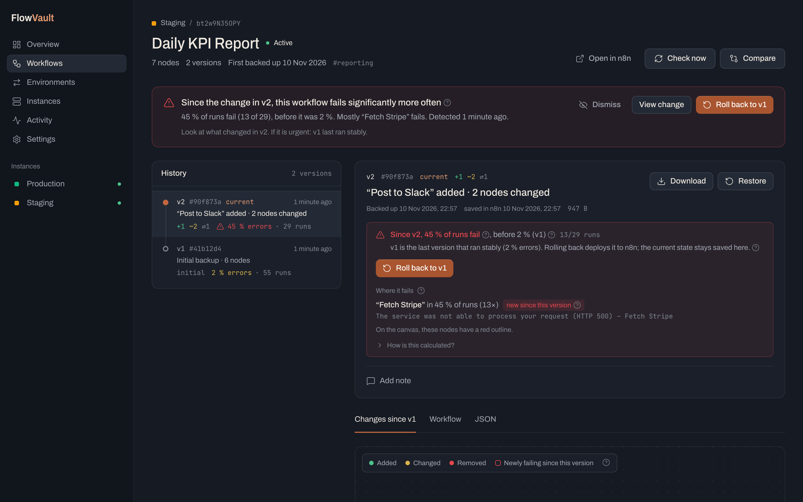
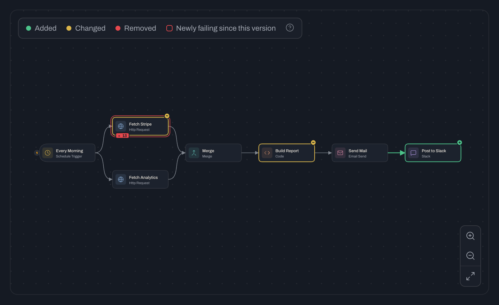

# FlowVault – version control and backup for n8n

Connect as many n8n instances as you like. FlowVault backs up all workflows automatically, creates a new version on every change and shows you visually what changed.



*Deutsche Version: [README.md](README.md)*

**Status: early development (0.x).** FlowVault is self-hosted and uses a single admin account with email and password plus optional two-factor authentication (TOTP). Multiple users and roles are not implemented. The project is independent of n8n and GitHub.

[Quick start](#quick-start-local) · [Docker](#running-with-docker) · [Configuration](#configuration) · [Security](#security) · [Development](#development) · [Contributing](CONTRIBUTING.md) (German) · [Security reports](SECURITY.md) (German)

## Features

- **Multiple instances**: production, staging, customer instances – all in one place
- **Automatic backups** at an adjustable interval (5 minutes to daily) or manually
- **Version history** like Git commits, with an automatically generated description (“‘Slack’ added · ‘HTTP Request’ changed”) and your own notes
- **Visual diff**: workflow canvas with colour-marked nodes (new / changed / removed), changes per node, changed connections, full JSON diff
- **Compare any versions**
- **Restore**: write a version back to n8n – or create it as a copy, also on another instance (staging → prod)
- **Environments (staging → prod)**: promote workflows between instances without tripping over IDs – FlowVault replaces credentials, sub-workflow and error-workflow IDs, data table IDs and webhook paths based on mappings you save once. The drift view shows which workflows differ between two instances and in which direction (see [Environments](#environments-staging--production))
- **Deleted workflows** are kept with their complete history
- **Archived workflows** are skipped by default. Switch them on per instance under *Edit instance → Back up archived workflows*. History that was already saved is kept (Workflows → “Archived”).
- **Which change broke it?** FlowVault fetches the executions from n8n and lays them over the version history: failure rate per version (“since v14, 38 % fail, before 0 %”), the node that has been failing since the change marked red in the diff canvas, and a warning with a rollback suggestion when the rate rises. Rollback with one click. It runs as its own process inside FlowVault, see [Health service](#health-service-failure-rate-per-version)
- **AI agents can ask (MCP)**: Claude, ChatGPT or Cursor ask, read-only, how your instances are doing and which runs failed. No workflow content, secrets in messages masked, off by default. See [AI agents (MCP)](#ai-agents-mcp)
- **Download** every version as JSON that n8n can import
- **Customisable dashboard**: show or hide key figures, change history, recent changes, the instance overview and health warnings individually ([details](docs/DASHBOARD.md), German)
- Activity feed and heatmap, sync log per instance
- **English and German**: interface, error messages and AI texts; more languages can be added without code changes (see [Languages](#languages))
- API keys and workflow snapshots encrypted with AES-256-GCM, sign-in with email and password, optional 2FA with an authenticator app and one-time recovery codes (see [Security](#security))
- **AI change texts (optional)** via [Melious](https://melious.ai): a model on EU infrastructure writes a commit-style title plus bullet points for every new version. Credentials are filtered out beforehand (see [AI change texts](#ai-change-texts-optional))

Only real changes create versions – runtime data such as `staticData` (e.g. polling timestamps) is ignored.



*Screenshots with demo data from the included mock (`npm run mock-n8n`).*

## Quick start (local)

Prerequisites: **Node.js ≥ 22.18** (24 recommended) and Git. No database needed – SQLite is built in.

```bash
git clone https://github.com/rootbyteDS/flowvault.git
cd flowvault
npm ci
npm run build
npm start            # → http://127.0.0.1:4000
```

On first access, you choose the email and password for your admin account and then connect your first instance. For that you need the **setup code** the server prints to the terminal on startup – so nobody else can take over a freshly started instance. Afterwards, you can enable 2FA under **Settings → Two-factor authentication**.

For running it on a server, see [Running with Docker](#running-with-docker).

### Getting an n8n API key

In n8n: **Settings → n8n API → Create an API key**. The key needs read access to workflows (and write access for restoring and promoting). For the failure rates, read access to executions is needed as well. Whether the public API and individual permissions are available depends on your n8n installation.

## Running with Docker

In the cloned project folder (see [Quick start](#quick-start-local)):

```bash
cp .env.example .env
openssl rand -base64 32
```

Enter the generated value in `.env` after `APP_SECRET=`. Keep the file and the key; with an existing installation, do not generate a new key. Then start:

```bash
docker compose up -d --build
docker compose logs flowvault  # shows the setup code for the admin account
```

Docker Compose passes these variables from the `.env` to the container: `APP_SECRET`, `ADMIN_EMAIL`, `ADMIN_PASSWORD`, `TRUST_PROXY`, `DEFAULT_LANGUAGE` and the `UPDATE_…` variables (see [Configuration](#configuration)). Port, bind address and data directory are fixed in the container. After changing the `.env`, `docker compose up -d` applies the new values. To get English server logs and AI texts, add `DEFAULT_LANGUAGE=en` (see [Languages](#languages)).

The port is only exposed on `127.0.0.1`. To make FlowVault reachable from outside, use a reverse proxy with HTTPS (Caddy, Traefik, nginx) – and then **set `TRUST_PROXY=1`** in the `.env`, otherwise all sign-in attempts count against the proxy’s IP. If FlowVault runs in the same Docker network as n8n, you can enter e.g. `http://n8n:5678` as the URL.

For [Arcane](https://getarcane.app), `docker-compose.arcane.yml` is included. It builds directly from this GitHub repository; set `APP_SECRET` and the other variables in Arcane’s `.env` editor.

The container runs as user `node` (UID 1000). Hand over a volume from an older version (which ran as root) once. With Compose, this addresses the volume that is actually used, even if its name contains a project prefix:

```bash
docker compose stop flowvault
docker compose run --rm --no-deps --user root --entrypoint chown flowvault -R 1000:1000 /data
docker compose up -d
```

## Configuration

| Variable         | Default      | Description |
|------------------|--------------|-------------|
| `PORT`           | `4000`       | HTTP port |
| `HOST`           | `127.0.0.1`  | Bind address (`0.0.0.0` in the container) |
| `DATA_DIR`       | `./data`     | Location for the database and keys |
| `APP_SECRET`     | –            | Application key for API keys, 2FA and workflow snapshots. Without it, one is created automatically in `data/secret.key` during setup. Do not change or lose it. |
| `ADMIN_PASSWORD` | –            | Fixed admin password instead of setting it up in the browser |
| `ADMIN_EMAIL`    | –            | Fixed admin email; together with `ADMIN_PASSWORD` usable without initial setup. Without this variable, the email is set in the browser |
| `DEFAULT_LANGUAGE` | `de`       | `de` or `en`: language of the server logs and of the AI change texts, and fallback language of the interface (see [Languages](#languages)) |
| `TRUST_PROXY`    | –            | `1` behind a reverse proxy (mandatory, otherwise the sign-in lock applies to everyone) |
| `APP_REVISION`   | –            | Optional Docker build parameter for the built Git commit |
| `UPDATE_WEBHOOK_URL` | –        | External deployment webhook (POST); without it the UI update button is not active |
| `UPDATE_WEBHOOK_TOKEN` | –      | Optional bearer token for the deployment webhook, used server-side only |
| `UPDATE_MANAGEMENT_URL` | –     | Optional public link to the deployment history or Arcane project |
| `HEALTH_PORT`    | `4100`       | Internal port of the health service (`127.0.0.1` only, never exposed) |
| `MCP_PORT`       | `4200`       | Internal port of the MCP service (`127.0.0.1` only; agents reach it through the core’s `/mcp`) |

Docker Compose only passes the variables listed under `environment` in `docker-compose.yml`; add further ones there. When started directly via npm, `.env` is not loaded automatically: set variables in the shell, e.g. `PORT=4001 HEALTH_PORT=4101 npm start` (macOS/Linux).

FlowVault starts the health and MCP services itself as child processes and restarts them after a crash. If one fails, FlowVault keeps running normally, just without operating data or agent access. The core and the services use internal tokens that are stored automatically in `data/internal.token` and `data/mcp.token`.

## Backing up FlowVault itself

Back up `flowvault.db` (SQLite, workflow versions compressed and encrypted) from `DATA_DIR` and the key in use: either `secret.key` from the same directory or the value of `APP_SECRET` from your operating configuration. Stop FlowVault before copying the files and include `flowvault.db-wal`/`flowvault.db-shm` if present, or create a consistent SQLite backup. **Keep the database and its original key as a matching backup set**, preferably stored separately with their own access controls. Without the original key, encrypted workflow versions can no longer be read or restored; 2FA recovery codes do not replace this key. FlowVault refuses to start with a mismatched key.

**Updating existing installations:** On the first startup, previously unencrypted snapshots are encrypted automatically in one transaction. Free database pages and the SQLite WAL are then cleaned up before the API and background services start. Create a consistent backup including the existing key before updating. Migration may extend the first startup and requires up to roughly twice the database size in additional free space for cleanup. On failure, FlowVault does not start; after fixing the cause, migration or cleanup is retried on the next startup. Downgrading to a version without snapshot encryption cannot read this history. Earlier backups and filesystem snapshots are not encrypted retroactively.

For a simple file copy, stop FlowVault first (`docker compose stop flowvault` or stop the local server). Do not make an isolated copy of `flowvault.db` while it is running: SQLite additionally uses WAL files. Afterwards, start FlowVault again.

`health.db` contains derived execution data, warnings and the settings of the health service. Existing executions can be fetched again from n8n, as far as n8n still has them stored. Back up this file too if you want to keep settings and warning states. `mcp.db` contains the on/off switch and the fingerprints of the agent tokens; without it you have to switch access on again and create new tokens.

## Version and updates

What changed between releases is listed in the [changelog](CHANGELOG.md) (German) and on the [Releases](https://github.com/rootbyteDS/flowvault/releases) page. Every completed project change receives a higher version; selected states are published as releases. The Git hook, CI and the release process are described in [versioning](docs/VERSIONING.md) (German).

The installed version number is shown at the bottom of the sidebar. Clicking it opens **Settings → About FlowVault**. There you also see the Git commit (if known) and, in the Docker image, the build date. Local changes are marked separately. The information comes from the running server, not from a version number hard-coded in the frontend. There is currently no automatic check for newer releases.

### Updating manually

With Docker from a local checkout, first make sure you have the [FlowVault backup](#backing-up-flowvault-itself), then run in the project folder:

```bash
git pull --ff-only
APP_REVISION="$(git rev-parse HEAD)" docker compose build --pull flowvault
docker compose up -d flowvault
```

The build parameter `APP_REVISION` stores the built commit in the image. Without it, a Docker image shows the version number and build date; a Git commit is not guessed. When started directly from a Git checkout, FlowVault detects the commit itself at server start. Then reload the page.

For the included `docker-compose.arcane.yml`, build and deploy the new state in **Arcane → Project → Build & Deploy**. A restart or merely pulling an image does not pick up new source code with this `build:` configuration. Without Docker: after `git pull --ff-only`, run `npm ci` and `npm run build` and restart the FlowVault process. Keep the data volume and `APP_SECRET`.

**Updating from a version without email sign-in:** first sign in with the previous admin password and then set the admin email once. Until then, the other functions are locked. The previous password is kept; the switch signs other devices out.

### Requesting an update from the interface

The **Request update** button becomes available as soon as an external deployment webhook is configured. Before every request, FlowVault confirms the current password and, with 2FA enabled, a fresh app or recovery code. The deployment service takes care of the actual rebuild and container replacement; FlowVault needs neither a Docker socket nor write access to its source code.

Set this in the `.env` of the Compose/Arcane project and redeploy the container once:

```dotenv
UPDATE_WEBHOOK_URL=https://deployment.example.com/trigger
# Only if the deployment service expects a bearer token:
UPDATE_WEBHOOK_TOKEN=
# Optional: link to the project or deployment history, shown in the browser:
UPDATE_MANAGEMENT_URL=https://deployment.example.com/projects/flowvault
```

The webhook receives a JSON POST with `app`, the installed `version`, the known `revision` and `requestedAt` (Unix milliseconds). It must accept the job promptly with HTTP 2xx and run it in the background. An optional token is sent as `Authorization: Bearer …`. Target and token come exclusively from the server configuration and are never sent to the browser. Redirects are not followed. On a timeout after ten seconds or a dropped connection, the outcome is shown as unclear; there are no automatic retries. Concurrent requests are blocked, with at least two minutes between attempts. The deployment service should also prevent parallel jobs.

**Arcane:** According to its [webhook documentation](https://getarcane.app/docs/reference/api), webhooks are created under **Settings → Webhooks**. Choose only the affected project as the target. A project-redeploy webhook can update provided images; for our current source-code build that alone is not enough: the connected job must run **Build & Deploy**. For example, trigger a dedicated deployment job through a webhook. Until that is set up, build and deploy directly in Arcane. `UPDATE_MANAGEMENT_URL` can point to the Arcane project.

An accepted request does **not** mean the update was installed successfully. Check the history in the deployment service and reload FlowVault afterwards; the displayed version and build information then show the running state.

## Restoring and credentials

For n8n credentials, FlowVault only saves references (type, ID and name), not the secret values themselves. Restoring on the same instance also applies the references from the selected version: if v1 uses credential A and v2 uses credential B, restoring v1 points back to A. The **current** secret values of A are used; earlier passwords or tokens are not restored. Credentials that were deleted or recreated with a new ID must be reassigned in n8n. Their availability is not checked when restoring on the same instance; the dialog explains this.

## Environments: staging → production

In practice, copying between instances fails on IDs that are different everywhere: credentials (“Slack Staging” ↔ “Slack Prod”), sub-workflow IDs in Execute Workflow, error workflows in the settings, data table IDs, webhook paths. **Environments** supports this promotion through the n8n public API with its own mappings:

1. **Set up an instance pair**: choose source and target explicitly and save them for this direction. The first two instances are never picked automatically. The reverse direction needs its own setup; existing mappings are kept, but on their own they do not allow a promotion.
2. **Pair workflows**: for relevant source workflows, confirm the existing counterpart or choose “Create on target (inactive)”. Matching IDs and names are only suggestions. Explicit pairings take precedence; a missing target requires a new decision. Within a pair, a target workflow can be assigned to only one source. Workflows you do not need may stay open and are shown as “Not paired yet”.
3. **Map dependencies**: confirm credentials, sub-/error workflows and data tables. Suggestions use the n8n public API (if read access to credentials is available) and saved snapshots. Credentials are filtered by type; ambiguous name matches are not treated as unique. Without full API read access, target resources may have to be entered manually and checked in n8n. Webhook paths can stay identical without replacement.
4. **Review and transfer**: select workflows individually or via checkbox. The review shows the concrete target workflows, versions, changes via “Diff” and any additionally required new sub-/error workflows. Once their creation is confirmed, these are included automatically and created before their callers. Their new IDs are used in the same run and saved for repeated runs. Missing required mappings block the whole plan before the first write.

Existing target workflows are read from n8n and backed up before writing. Changes since the review require a new review; changes to source versions, pairings or instance configuration also invalidate the plan. After writing, the content writable through the API is read back and compared. On an error, the following promotions are stopped and individual results are shown. Writes that already happened stay in place; there is no cross-instance transaction and no atomic lock against parallel changes made directly in the n8n editor.

New circular dependencies must first be created and mapped separately on the target. Dynamic workflow/data table references cannot be checked statically and block the reviewed promotion. Normal expressions in input fields stay unchanged. The replacement also handles n8n resource locators (`{ value, mode, __rl }`). Active status, tags and pin data are not part of the writable n8n workflow payload; activation happens separately in n8n.

Copying from the version history to another instance also requires a configured pair and complete reference mappings. A copy does not replace an existing workflow pairing. Matching credentials must exist and be usable on the target; matching names alone are not sufficient. Their secret values are not transferred. The target instance is only reached through its saved address and its own API key.

## Health service: failure rate per version

GitHub only sees the code, not how it runs in production. FlowVault connects both: every execution from n8n is assigned to the workflow version that was running at that time.

- **Assignment**: What counts is the time of saving in n8n (`updatedAt`), not the time of the backup. If n8n supplies a `workflowVersionId` on the execution, it takes precedence. If you save several times between two backups, the runs in between land on the previous saved version. A shorter sync interval makes the assignment more precise.
- **Assessment**: A version is only judged from a minimum number of runs (default 5). It is compared with the versions before it. If the failure rate rises by at least 20 percentage points, there is a warning on the overview and on the workflow, with a suggestion of the last stable version. Nothing is rolled back unless you click, never automatically.
- **Test runs** from the editor (`mode: manual`) do not count by default.
- **Data-minimal**: The core reduces every execution to status, time, mode, node name and error message before passing it on. Input and output data never leave the core. API keys do not either: the health service fetches the executions through the core’s internal API, not directly from n8n.
- **Limits**: At most 10,000 executions and 200 errors with details per instance per fetch. Very busy instances therefore do not fetch older runs completely on the first fetch. The n8n API key needs read access to executions.

All thresholds are under **Settings → Failure rate per version**.

## AI agents (MCP)

Through the [Model Context Protocol](https://modelcontextprotocol.io), AI assistants such as Claude, ChatGPT or Cursor ask FlowVault how your n8n instances are doing: “How are my instances doing, is there anything I should look at?” or “Did you notice anything in recent executions?”. Access is **read-only** and off by default.

**Setup:** Switch it on under **Settings → Access for AI agents (MCP)** and create one token per agent, optionally limited to certain instances. The token is shown exactly once. In the agent, enter the address `https://<your-flowvault-address>/mcp` and the header `Authorization: Bearer fv_mcp_…`, for example:

```json
{
  "mcpServers": {
    "flowvault": {
      "type": "http",
      "url": "https://flowvault.example.com/mcp",
      "headers": { "Authorization": "Bearer fv_mcp_…" }
    }
  }
}
```

| Tool | Answers |
|------|---------|
| `get_status` | Verdict per instance (ok, warning, critical) with reasons: sync, execution fetching, open alerts, failures of the last 24 hours |
| `list_recent_failures` | Failed runs grouped by workflow, node and message, with a note whether the workflow has run successfully since |
| `list_alerts` | Open alerts with failing nodes and a rollback suggestion |
| `get_workflow_health` | Failure rate per version of one workflow |
| `get_recent_changes` | Workflows created, changed, deleted or restored, sync errors |
| `list_workflows` | Backed-up workflows with state, number of nodes and versions |

- **Read-only**: Agents cannot sync, restore or change anything. The MCP service never calls n8n itself; it reads what FlowVault has already stored. The data is as fresh as the last fetch (every 5 minutes by default); every answer states how fresh it is.
- **No workflow content**: No JSON, no node parameters, no diff, no AI texts. Keys entered by hand in nodes therefore do not reach the agent through the workflow.
- **Masking in messages**: Error messages and names are masked before they go to the agent: keys and tokens (named values such as `API key: …`, typical key formats, query parameters in URLs, credentials in URLs) and e-mail addresses (`j***@example.com`). In FlowVault itself you still see the full messages. Masking works with patterns; a short key without a recognisable format in the middle of free text can slip through.
- **Tokens**: Only a SHA-256 fingerprint is stored in `data/mcp.db`. One token per agent, revocable individually, with “last used”. After 10 wrong tokens from one address, FlowVault slows that address down (like the login lock).
- **Separate process**: Like the health service, the MCP service runs as a child process on `127.0.0.1` and is only reachable through the core’s `/mcp`. It gets no `APP_SECRET` and its own token, which the core accepts for read-only calls only. It runs in the same container under the same user; this separates interfaces, not the file system.

## AI change texts (optional)

Via [Melious](https://melious.ai), a model on EU infrastructure writes a commit-style title plus bullet points for every new version. Set it up under **Settings → AI change texts**: switch it on and enter an API key; that is also where you choose the language of the texts (see [Languages](#languages)). Without an API key, nothing is sent to an AI.

- **What is sent**: only the changed nodes and parameters. The whole workflow only if you request a text for a first version yourself.
- **What is removed beforehand**: values of fields, headers and parameters such as `password`, `token`, `apiKey`, `key`, `Authorization` or `X-…-Auth`, typical key formats (Bearer, JWT, `sk_…`, `ghp_…`, AWS, Telegram), credentials in URLs (`user:password@host`), Slack and Discord webhook addresses, and long, random-looking strings (for example hex or Base64 keys as a constant in code).
- **Limits**: This is a heuristic. Credentials belong in n8n credentials, not in code nodes. The mock shows what would actually be sent with `MOCK_LOG_PROMPT=1` (see [Development](#development)).

## Languages

The interface is available in **English** and **German**. It first follows the browser language; with the language selector on the sign-in page and under **Settings → Language**, it can be switched per browser. Server error messages appear in the same language.

With `DEFAULT_LANGUAGE=en` (in the `.env` or in Arcane), FlowVault writes the server logs – e.g. the setup code in `docker logs flowvault` – and new AI change texts in English; the interface falls back to it when the browser reports no supported language. The language of the AI texts can additionally be chosen under **Settings → AI change texts**.

Further languages are a folder of text files, with no changes to the program code: [docs/I18N.md](docs/I18N.md) (in German).

## Security

Anyone signed in to FlowVault can write workflows to all connected n8n instances. That is why:

- **Setup only with a code** from the server log.
- **Sign-in lock**: After 5 wrong attempts (sign-in, setup, password or code confirmation), FlowVault locks the address with a growing waiting time (1 to 15 minutes). IPv6 addresses count per /64 network. Attempts sent in parallel are not checked more often than attempts sent one after another. Across all addresses, sign-in pauses after 50 failed attempts within 15 minutes until the window expires. This slows down attacks from many addresses, but during an ongoing attack it can also lock you out; existing sessions stay valid.
- **Admin account**: Sign-in with email and password. The email is used as the sign-in name and is not confirmed by mail. Mail delivery and password reset by email are not implemented yet. Values configured via `ADMIN_EMAIL` or `ADMIN_PASSWORD` cannot be changed in the browser. 2FA can be enabled with these variables as well and then applies in addition to the password.
- **2FA (optional)**: Start under **Settings → Two-factor authentication** with the current password, scan the QR code with an authenticator app (or enter the key manually) and confirm a six-digit app code. The setup is valid for ten minutes and not active until confirmed. The TOTP secret is stored encrypted with AES-256-GCM. App codes are valid for 30 seconds, with one time step of tolerance in both directions; accepted codes cannot be reused. Server and phone should have synchronised clocks.
- **Recovery codes**: When enabled, ten random codes are shown once and can be downloaded as a text file. Keep them safe, separate from the password. A code replaces the app code once; the password is still required. Only SHA-256 hashes are stored. New codes can be created with the password and a valid app or recovery code; that invalidates all old codes. If you lose your phone, sign in with a recovery code and disable 2FA with another code, then set it up again.
- **Signing in with 2FA**: After a valid email and password, there is only a sign-in check valid for five minutes, no session or API access yet. After five wrong codes, this check becomes invalid even if the IP changes. QR setups are bound to the signed-in session and discarded after five wrong codes.
- **Sessions**: HttpOnly cookies with `SameSite=Strict` (additionally `Secure` under HTTPS); session tokens and sign-in checks are stored in the database only as SHA-256. Changes to the email or password, as well as enabling/disabling 2FA and renewing the recovery codes, sign out all other devices and discard pending sign-ins. Such changes require the current password and, with 2FA enabled, additionally a fresh app or recovery code.
- **CSRF**: Writing requests only from the own site (`Sec-Fetch-Site`/`Origin`) and only as JSON.
- **API keys** leave FlowVault only to the saved address. If the URL of an instance or of the AI API is changed, the key has to be entered again. Redirects are not followed; cloud metadata addresses (169.254.x.x) are blocked.
- **Headers**: strict Content-Security-Policy, no embedding in other sites, HSTS behind an HTTPS proxy.
- **Files** in `DATA_DIR` are readable only by the user FlowVault runs as.
- **Fonts** are served locally; the browser loads nothing from third parties.

**Workflow snapshots** are compressed in full and stored encrypted with AES-256-GCM, including keys entered directly in nodes, pin data (test data) and `staticData`. Tampered encrypted content is rejected when read. Encryption protects stored snapshots if someone accesses the database without the application key. Workflow names, change summaries, notes and AI texts remain unencrypted; do not put secrets there. Signed-in users can view, copy, download and restore the decrypted contents; exported JSON files are not encrypted. Protect the database, key and exports accordingly. Inline secrets remain part of every affected version; use n8n credentials for secret values where possible. If a key has already been exposed, revoke or rotate it with the provider – encryption does not undo earlier exposure.

Please report vulnerabilities confidentially according to [SECURITY.md](SECURITY.md), not as a public issue.

## Development

After `npm ci`, start development with `npm run dev`. Run the mock and the test commands below each in another terminal. In FlowVault, connect the mock via `http://localhost:5679` with the API key `test-key`; no real n8n instance is needed for that.

```bash
npm run dev          # API (port 4000, also starts the health service) + Vite frontend (http://localhost:5173)
npm run mock-n8n     # fake n8n on port 5679, API key: test-key, keeps generating executions
MOCK_ENV=Prod MOCK_PORT=5680 npm run mock-n8n   # second fake instance with its own IDs – for environments (staging → prod)
curl -X POST localhost:5679/_mock/mutate   # simulates a workflow change
curl -X POST localhost:5679/_mock/break    # change after which a node fails in 40 % of runs
curl -X POST 'localhost:5679/_mock/run?n=30'  # immediately 30 runs per active workflow
npm test             # auth/2FA tests, environment mappings, health analysis and translations
# The mock also plays Melious: API address http://localhost:5679/v1, key test-ai-key
MOCK_LOG_PROMPT=1 npm run mock-n8n          # shows what would be sent to the AI
npm run typecheck
```

Before a pull request: bump the version and run the checks, see [CONTRIBUTING.md](CONTRIBUTING.md) (German).

## Architecture

```
server/          Node.js + Express (TypeScript, runs natively without a build)
  index.ts       REST API & serving of the frontend
  auth-router.ts Admin account, email migration, 2FA and confirmed update trigger
  version.ts     Version and build information of the running server
  updates.ts     Optional external deployment webhook
  auth.ts        Password check, sessions and sign-in lock
  two-factor.ts  TOTP check, replay protection and recovery codes
  dashboard.ts   Saved dashboard selection (/api/dashboard/layout)
  sync.ts        Sync engine, scheduler, restore
  n8n.ts         Client for the n8n public API
  net.ts         Outgoing requests: no redirects, cloud metadata blocked
  internal.ts    Internal API for services (token) + forwarding /api/health → health service
  mcp.ts         /mcp for agents (forwarding, lock) + management /api/mcp → MCP service
  ai.ts          AI change texts via Melious, queue, secret filter
  promote/       Environments (staging → prod)
    pairs.ts     Instance pairs and decisions to create new workflows
    mappings.ts  Mapping store, suggestions, workflow pairing
    plan.ts      Write-free promotion planning, dependencies before callers
    transform.ts Replaces IDs in snapshots – purely functional + tests
    drift.ts     Differences between two instances
    promote.ts   Promotion to the target instance
    router.ts    HTTP API of the module (/api/promote)
  db.ts          SQLite schema (node:sqlite)
  crypto.ts      Encryption, password hashing, compression
  services.ts    Starts and supervises the health and MCP services (child processes)
services/health/ Health service: executions ↔ versions, failure rates, warnings
  index.ts       HTTP API (for the core only)
  core.ts        Client for the core’s internal API
  poller.ts      Fetches executions through the core
  analysis.ts    Pure analysis (assignment, failure rate, rollback suggestion) + tests
  evaluate.ts    Links the analysis with versions, maintains warnings
  db.ts          Own SQLite database (health.db)
  failures.ts    Failed runs grouped and totals per instance (for the MCP service)
services/mcp/    MCP service: read-only tools for AI agents
  app.ts         HTTP: /mcp and management (only via the core)
  tools.ts       Tools, fixed output fields, masking
  verdict.ts     Verdict per instance (ok, warning, critical)
  store.ts       On/off and token fingerprints (mcp.db)
  core.ts        Client for the core’s internal API (read-only)
shared/          Used by server, service and browser
  diff.ts        Workflow comparison
  executions.ts  Reduce executions, types for core, service & browser
  redact.ts      Masking of credentials (AI texts, MCP)
  mcp.ts         Response types of the MCP tools
  dashboard.ts   Widget IDs, storage format and validation of the dashboard
  i18n/          Languages: translator and texts (German, English)
web/             React + Tailwind (Vite)
scripts/         Mock n8n for testing, version check, Git hook installation, build info
```

## Contributing

Notes on development, bug reports and pull requests are in [CONTRIBUTING.md](CONTRIBUTING.md) (German), the version number workflow in [docs/VERSIONING.md](docs/VERSIONING.md) (German). The GitHub Actions under [`.github/workflows/ci.yml`](.github/workflows/ci.yml) check the version bump, tests, TypeScript and the frontend build with Node.js 22.18 and 24.

Please do not report security issues as an issue, but confidentially according to [SECURITY.md](SECURITY.md).

## License

FlowVault is released under the [MIT license](LICENSE). Dependencies are subject to their respective licenses.
